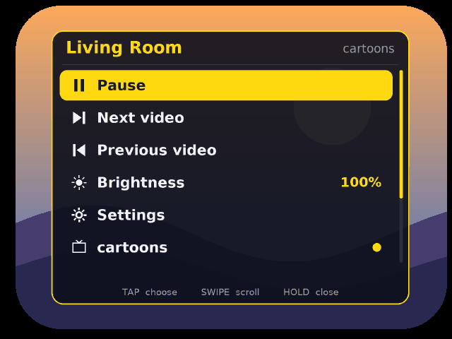
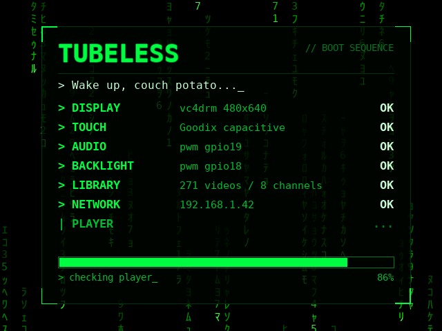
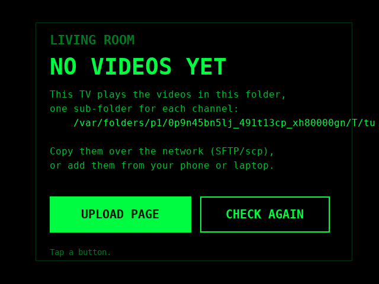
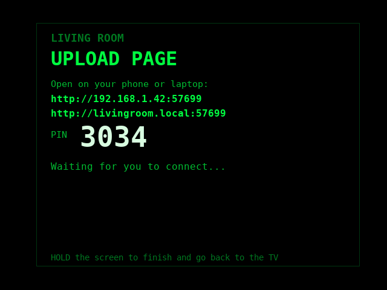
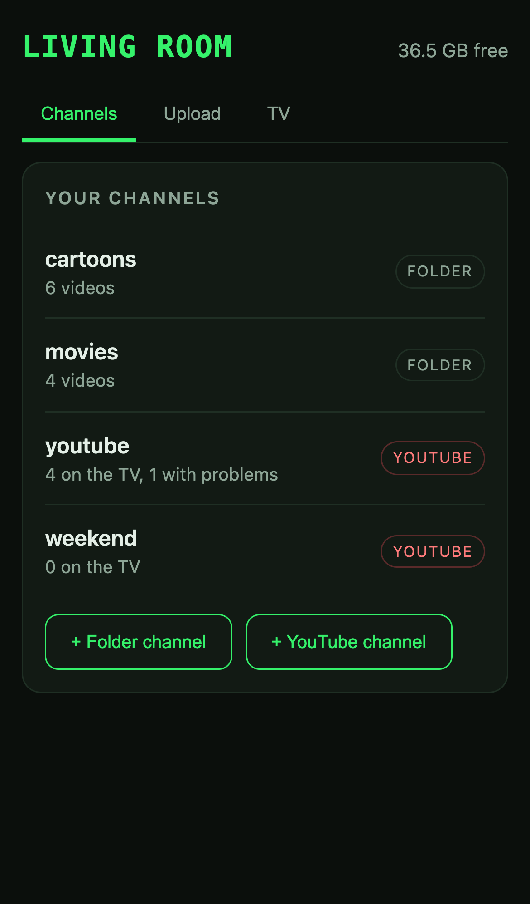
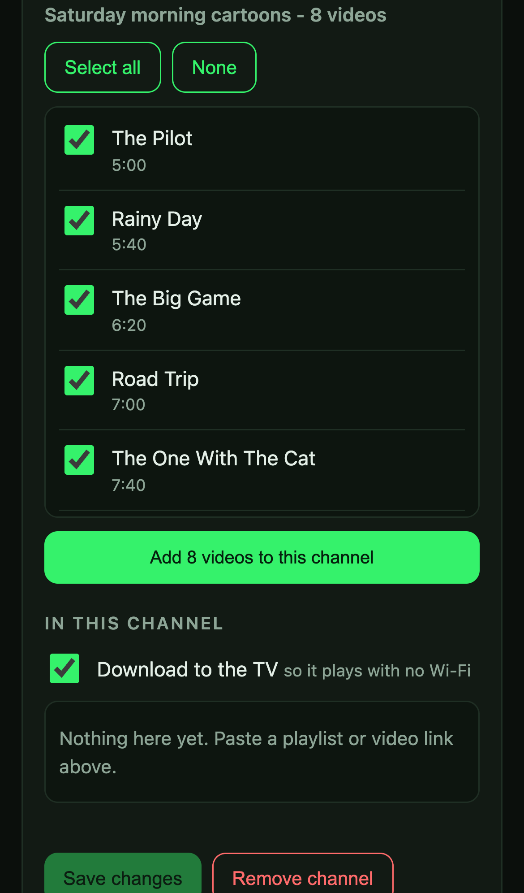
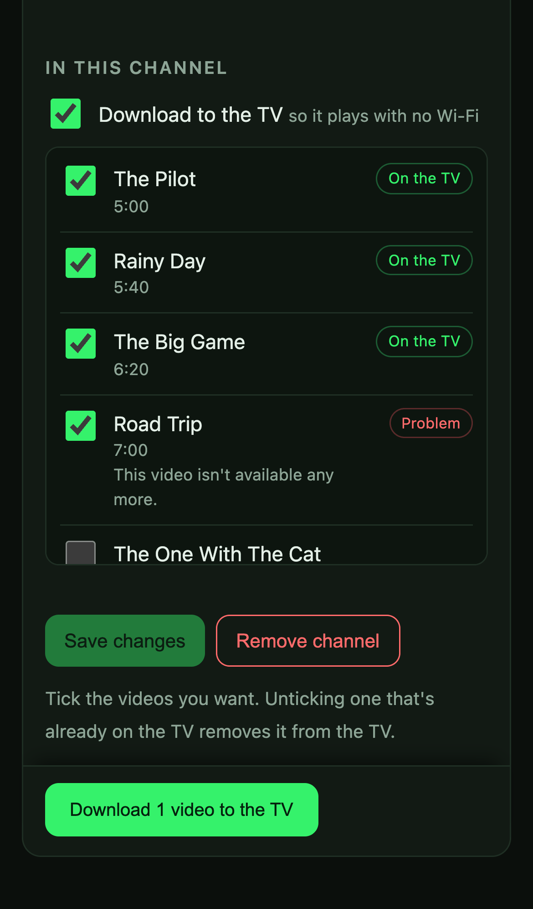
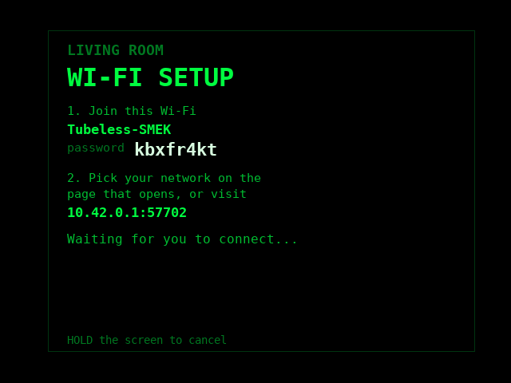
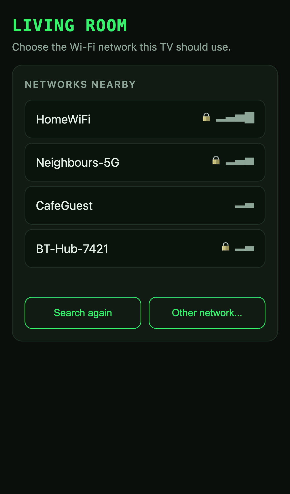

# Tubeless

A pocket TV with no tube. A Raspberry Pi Zero 2 W, a 2.8" touchscreen in a 3D-printed retro shell, a small speaker and a
folder of videos. Swipe to change channel. A burst of static plays between episodes.

<p align="center">
  
  
</p>

> **Status: early.** It runs on the author's TV every day, and this is the first public cut. It supports one build only (see
> [Hardware](#hardware)). Settings and file layouts may still change.

## What it does

* **Channels are folders.** Put videos in `~/videos/1.cartoons`, `~/videos/2.movies` and so on. Swipe up or down to change channel.
* **Touch controls.** Swipe left or right for the next or previous episode, tap to pause, hold for the menu.
* **Static between episodes.** A short burst before every video and a longer one when you change channel.
* **Shuffle that doesn't repeat.** Each channel remembers its shuffled order and works through it. New videos are slotted in
  among the ones you haven't seen.
* **Resume.** It returns to the right episode and the right place in it, even after you pull the plug.
* **No keyboard on the TV.** The Wi-Fi password, the TV name and YouTube links all go through a web page on your phone.
* **YouTube channels** (optional): playlists and single videos, downloaded to the TV or streamed, at a quality you choose (360p by default).
* **Looks after itself.** If the picture stalls or a stream hangs the TV restarts the player and shows a "technical difficulties"
  picture meanwhile; if the Wi-Fi chip locks up it reloads it, and restarts the TV once as a last resort (see
  [Wi-Fi chip and the slower bus clock](#wi-fi-chip-and-the-slower-bus-clock)). Once a minute it writes a health note to the log (power
  flags, temperature, load, free memory, Wi-Fi signal), so a stutter can be lined up with what the Pi was doing.
* **Menu:** pause, next and previous, brightness, channels, and under Settings: shuffle, sleep timer, auto-dim,
  touch calibration, upload, Wi-Fi setup, shut down. Two icon buttons at the top right of the menu go straight to **shut down** and to
  **upload and settings mode**; each asks for a second tap within a few seconds before it does anything.
* **Dimming.** A paused picture dims after a minute untouched. Auto-dim (2, 5 or 10 minutes, or off) dims a playing one. A touch
  wakes the screen and does nothing else.
* **Dim at night** (optional, off until you switch it on): full brightness by day, then a fade down to the night level (25% unless you
  choose another) over half an hour from sunset, and back up before sunrise, like a Mac's day and night cycle. The TV has no GPS, so give
  it a place on the upload page: type a latitude and longitude, or press *Use my time zone's city* (the TV's own time zone, good to a quarter
  of an hour), or *Use this device's location* (browsers only allow that on https pages, so it usually can't work on the TV's plain http
  page). Without a place it uses two times you set (21:00 to 07:00 to begin with), and so does somewhere the sun doesn't set. The Pi has
  no battery-backed clock, so dimming waits until the TV has set its clock from the network (it needs Wi-Fi once per start-up; after that it
  keeps working if the Wi-Fi drops). The menu's brightness row changes the night level at night and the daytime one by day.
* **Boot screen** with a live checklist of what is starting up, and a name and wake-up message you choose (on the upload page).

## Get videos onto the TV

With no videos the TV says so and offers an upload page. The same page is under Settings > Upload videos.

<p align="center">
  
  
</p>

The TV shows an address, a QR code and a 4-digit PIN. Open the address on a phone or laptop on the same Wi-Fi and enter the PIN.
Only someone who can see the TV can get in. From there you can:

* create channels and send video files (large files upload in pieces, and a dropped connection resumes);
* get advice on files that may not play well (resolution, codec, bitrate). Nothing is converted for you;
* rename the TV and change the wake-up message typed out on the boot screen (up to 40 characters; blank for the standard one);
* change the "technical difficulties" picture shown when the player restarts;
* choose the **TV static**: the built-in one (with sound, or silent), no static (just a quick blank), or your own clip, uploaded or
  picked from the TV's home folder (never your videos folder). With ffmpeg (YouTube support installs it) the TV can also change a clip's
  sound once, when you choose it: add the TV static sound, make it silent, or use a sound file you upload. One clip is enough: the TV plays
  only the first 0.6 seconds of it between videos and the first 3 seconds when you change channel (both adjustable; a clip shorter
  than that is repeated to fill the time). The built-in static keeps its own short and long clips;
* set a channel to play **in order** or **shuffled** (a YouTube channel's "in order" follows its playlist), or leave it following the TV's Shuffle setting;
* choose a **theme** for the menu, the information screens and the page itself (the original yellow and green, a neobrutalist one, Nord, Dracula, Gruvbox, Solarized light), or paste a palette from a colour-sharing site (hex codes or a coolors.co link) and the TV works out the background, text and accent, keeping the text readable. The boot screen keeps its Matrix rain;
* set brightness, auto-dim, the sleep timer and shuffle, choose the **YouTube picture quality** (240p, 360p or 480p; 360p is the default and is plenty for this screen), and see the TV's status and recent log;
* see how long each channel is (video lengths are read with `mediainfo` while the TV is in upload mode);
* check for a newer release and update the TV from the page (see Updating below);
* build YouTube channels (below).

Hold the TV's screen to leave the upload page. Copying files over SFTP or `scp` into `~/videos/<channel>/` works too.

## YouTube channels

A channel can be made of YouTube playlists and single videos. Paste a playlist link and every video in it is ticked. Untick any you
don't want. Later you can paste another playlist, or one video, and it merges into the same channel without touching your earlier choices.

<p align="center">
  
  
  
</p>

* **Download to the TV** (the default). The TV fetches each video at the quality you chose (360p by default), then plays it like any other file. It works
  with no Wi-Fi. Downloads run one at a time while the phone page is open, and the TV shows the progress.
* **Stream** (untick the box). Nothing is stored. Each video loads from YouTube when its turn comes, and the TV says "Loading from
  YouTube". The first one takes about 12 seconds on a Zero 2 W. After that, while a video plays the TV works out the next one's address in
  the background, so the changeover is usually quick (the setting is **Faster YouTube changeovers**, on by default; it costs a little
  memory and processing, and stays off on an mpv older than 0.38). Swiping back to an earlier video is not prepared in advance, so it
  takes the full 12 seconds. If a video can't be played the TV says why and moves on. Fix or delete the channel on the phone page.
  A live stream can't be added.
* Public and unlisted playlists only. There is no YouTube sign-in.

**New videos in your playlists.** Each time the upload page starts, the TV looks through the playlists your YouTube channels were built
from (this only reads the lists, it downloads nothing). Anything new shows on the page marked **New** and unticked, with the count in the
channel list. Tick the ones you want, save, and press Download. **Check for new videos** on the Channels tab looks again, and
**Not interested** clears the marks. Nothing is ever downloaded, ticked or removed for you.

This needs two extras, which the installer adds when you ask (`--with-youtube`, see [Install](#install-on-a-fresh-pi)):
[yt-dlp](https://github.com/yt-dlp/yt-dlp) and ffmpeg. Tubeless does not include either. YouTube changes often, so keep yt-dlp current. The upload page's TV tab has a **YouTube downloader** card that shows the
version, checks for a newer one and updates it (not while videos are downloading). Or from a shell on the TV:

```
python3 -m tubeless youtube status
python3 -m tubeless youtube update
```

Downloading from YouTube is against YouTube's terms of service, and this route doesn't show YouTube's ads. It is an opt-in extra for
your own use, and how you use it is up to you.

## Wi-Fi setup

A new TV, or one moved to a new router, has no network. Tubeless handles that without a keyboard.

<p align="center">
  
  
</p>

1. The TV makes its own Wi-Fi network and shows its name and password, with a QR code that joins it.
2. Your phone joins it and the setup page opens by itself (or go to `10.42.0.1`).
3. Pick your network, type its password, and the TV joins it and goes back to playing.

If the password is wrong the TV says so and brings its network back so you can try again. Your old Wi-Fi settings are kept until the
new ones work. A TV that has never had Wi-Fi starts setup by itself. A TV that has Wi-Fi saved but can't reach it keeps playing, since
it works fine offline. Start setup any time from Settings > Wi-Fi setup. Hold the screen to cancel.

This uses NetworkManager, so it needs Raspberry Pi OS Bookworm or Trixie. It isn't available on Bullseye.

## Wi-Fi chip and the slower bus clock

*For information. Your mileage may vary.*

**What.** One line in the Pi's boot configuration that runs the Wi-Fi chip's data bus at 25 MHz instead of its default 50 MHz:

```
# /boot/firmware/config.txt  (on Bullseye: /boot/config.txt)
dtparam=sdio_overclock=25
```

Then reboot. To undo it, delete the line and reboot. The installer does **not** add it for you: it is a manual change.

**Why.** The Zero 2 W's Wi-Fi chip (a Broadcom BCM43430) sits on an SDIO bus. On the author's TV, streaming from YouTube would sometimes
make that bus corrupt data. The picture froze, then the Wi-Fi went away completely and only a restart brought it back. The kernel log had
`brcmfmac` bus errors just beforehand. It happened on a battery supply and on mains, with the power flags clean, so it wasn't a supply
problem. Slowing the bus made it stop: with the line in place the TV streamed for hours (over 25 videos in a row) with no bus errors. We
haven't proven why it works. The usual suspect is a bus running right at its timing limit, which depends on the board, the wiring and the signal, so another
TV may not have the problem at all.

Tubeless also defends against it without the line. It checks every so often that the router answers a ping, reloads the Wi-Fi chip if
it doesn't, and restarts the TV once per boot if that fails (never while you are uploading, and only if the network had worked). That brings
the TV back, but you see a stall first. The slower clock avoids the stall.

**Does it make Wi-Fi slower?** In theory it halves the bus's ceiling, to roughly 50 Mbit/s in practice. This chip's radio (single
antenna, 2.4 GHz) usually manages 20 to 30 Mbit/s, so you shouldn't notice. We haven't measured it. Uploads are more likely held back by
the SD card and by ffmpeg.

**Where.** The line goes in `config.txt` on the boot partition (`/boot/firmware/` on Bookworm and Trixie), as a plain `dtparam`. Don't use
`dtoverlay=sdio,sdio_overclock=25`, which looks similar: that overlay moves the SDIO bus onto GPIO pins 22 to 27, and on this build
those pins drive the display, so the TV won't boot. If that has happened, take the card out, remove the line from `config.txt` on
your computer and put it back.

To see whether a TV has the problem, look for bus errors in the log after a stall:

```
journalctl -k | grep -i brcmfmac
```

## Install on a fresh Pi

You need the build from the original guide (see [Credits](#credits)): a Pi Zero 2 W, the Waveshare 2.8" DPI LCD, a speaker and the wiring.

1. Flash **Raspberry Pi OS Lite (32-bit, Trixie)** with the Raspberry Pi Imager. In its settings set a hostname and user, your Wi-Fi
   and Wi-Fi country, and turn on SSH with your public key.
2. Boot the Pi and SSH in. The screen stays dark until the installer has set up the display. Run the one-line installer (it downloads the
   latest release, checks its SHA-256 and runs `install.sh`; `sudo` will ask for the user's password):

   ```
   curl -fsSL https://raw.githubusercontent.com/magicows/tubeless/main/get.sh | sudo sh -s -- --name "Living Room"
   ```

   Add `--with-youtube` for YouTube channels. Add `--dry-run` first to see what it would do without changing anything. It takes 30 to 45
   minutes on a Zero 2 W, nearly all of it installing packages. If you prefer, clone the repository and run `sudo sh install.sh --name "Living Room"`.

   The installer:
   * tests the SD card by writing data and reading it back;
   * installs the packages it needs, without the recommended extras (a 512 MB Pi runs out of memory otherwise);
   * downloads Waveshare's display overlays and checks each file against a known checksum;
   * edits `config.txt` and `cmdline.txt`, showing the changes and keeping backups;
   * installs the services and a narrow `sudo` rule: power off, reboot, restart Tubeless, and one root-owned Wi-Fi helper.

   Run it again any time; it leaves anything already correct alone.
3. Reboot. The first start walks you through calibrating the touch screen. With no videos yet the TV offers the upload page.

## Updating

On the upload page, the TV tab has an **Updates** card: *Check for updates* asks GitHub for the latest release, and
*Update now* downloads it, checks its SHA-256, makes sure it starts, swaps the code in and restarts the TV. The code it replaced is
kept, so *Go back to ...* undoes the update. Videos and settings are never touched. If a release changes system files (the service
units), the page says so and you run `sudo sh ~/tubeless/install.sh` once over SSH.

A new TV can be installed in one line: `curl -fsSL https://raw.githubusercontent.com/magicows/tubeless/main/get.sh | sudo sh -s -- --name "Living Room"`
(it downloads the latest release, checks it, and runs `install.sh`).

To update a TV from your computer instead (this is how a git checkout updates): `tools/deploy.sh <ssh-host>`. Moving an existing SimpTV over? See
[docs/migrate-from-simptv.md](docs/migrate-from-simptv.md).

## Make it yours

Every TV has its own name, shown in the menu title and on the boot screen (up to 16 characters). Change it on the upload page or:

```
python3 -m tubeless config set name "Living Room" --restart
python3 -m tubeless config show
```

Themes are on the upload page (above). The folders and static clips are settings too (the wake-up message is on the upload page, or `config set boot_greeting`). Bigger themes (boot style, your own static, sounds) are on the
[roadmap](docs/ROADMAP.md).

## Hardware

| | |
|---|---|
| Board | Raspberry Pi Zero 2 W |
| Screen | Waveshare 2.8" DPI LCD (480x640 portrait, mounted sideways), Goodix touch controller |
| Backlight | GPIO 18, software PWM through pigpio |
| Audio | mono PWM speaker and amp on GPIO 19 (`dtoverlay=audremap,pins_18_19`) |
| OS | Raspberry Pi OS Lite 32-bit. Trixie is tested end to end. Bullseye (the original build's OS) plays videos, but uploads, Wi-Fi setup and YouTube are only tested on Trixie. |

All settings specific to this build are in [`tubeless/hardware.py`](tubeless/hardware.py). Support for another screen means adding a
profile there. Pull requests are welcome, but the project only promises the build above.

## Try it without a Pi

The simulator runs the real app against a pretend Pi and a pretend mpv, in your browser. The mouse is a finger.

```
python3 -m venv .venv && .venv/bin/pip install -r requirements-dev.txt
.venv/bin/python -m tubeless sim
```

Open <http://127.0.0.1:8765/>. Useful flags: `--fresh` (first-run calibration), `--screen boot`, `--no-network` (Wi-Fi setup),
`--fake-youtube` (a pretend yt-dlp).

## Development

```
.venv/bin/python -m pytest        # about 440 tests, including whole-app tests driven by synthetic touches
python3 tools/screenshots.py      # regenerates the pictures in docs/images (needs playwright and Chrome)
```

```
tubeless/        the app: app.py, library.py, web.py, youtube.py, wifi.py, hal/ (real and pretend hardware)
tests/           unit tests and whole-app tests
tools/           deploy.sh, an on-TV end-to-end test, screenshots
packaging/       systemd unit templates and the Wi-Fi helper
docs/            architecture, roadmap, manual test plan, the Trixie trial
```

Continuous integration runs the tests on Python 3.9 and 3.13. A daily job checks the newest yt-dlp against what Tubeless relies on
and opens an issue if something breaks. Where this is going: [docs/ROADMAP.md](docs/ROADMAP.md).

## Credits

Tubeless exists because of the original **Simpsons TV** project by **buba447**:

* the build guide, at **<https://withrow.io/simpsons-tv-build-guide>** (and the Waveshare-screen version,
  <https://withrow.io/simpsons-tv-build-guide-waveshare>). The shell, the wiring and the idea come from there;
* the original player scripts, at **<https://github.com/buba447/simpsonstv>**.

Tubeless is a separate, from-scratch implementation for a different stack (Pi Zero 2 W, mpv, a touchscreen). It contains no code from
that repository, which has no licence of its own. If you build the TV, read the guide.

Also: **Waveshare**, whose wiki supplies the display and touch overlays this build needs (the installer fetches them from Waveshare;
they are not redistributed here), and the **DejaVu** and **Droid** font authors
([`tubeless/assets/fonts/LICENSES.txt`](tubeless/assets/fonts/LICENSES.txt)).

**No videos are included, and none ever will be.** Bring your own.

## Licence

[MIT](LICENSE). The shell design, the original guide and the original scripts belong to their own authors.
